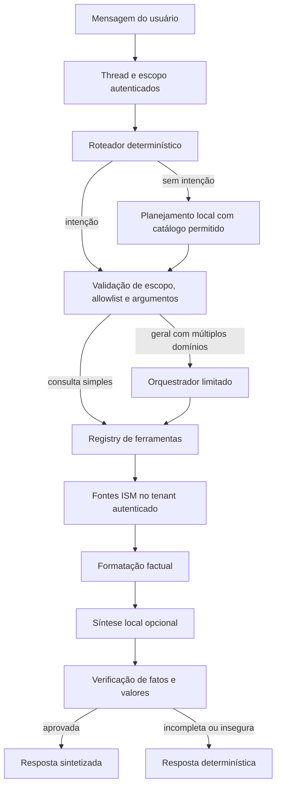

# Fluxo conversacional dos agentes ISM

**Atualizado em:** 25/11/2026

**Status:** fluxo implementado e validado para conversas autenticadas.

## Visão geral

O ISM oferece cinco identidades de conversa: `general`, `stock`, `pricing`, `suppliers` e `finance`. O especialista é gravado na thread e serve como limite de domínio. O agente consulta dados por ferramentas de leitura registradas no servidor; ele não recebe autorização para alterar preço, estoque, pedido ou fornecedor por meio dessas consultas.

O modelo local ajuda a interpretar perguntas que não são reconhecidas por regra determinística e a redigir respostas com base nos resultados. As ferramentas e o servidor continuam responsáveis por decidir o que pode ser consultado, aplicar o tenant autenticado e validar os fatos.

## Fluxo de uma mensagem

1. O usuário autenticado abre uma thread geral ou de especialista. O servidor valida a identidade pedida, o contexto de alerta e a entidade contextual contra o restaurante do usuário.
2. A mensagem é classificada pelo roteador determinístico. Na ausência de uma intenção reconhecida, o planejador pode pedir ao modelo local uma intenção estruturada, usando somente o catálogo permitido para aquela conversa.
3. A intenção passa pelo contrato da ferramenta: nome na allowlist, especialista compatível, argumentos aceitos e ausência de `restaurantId` enviado pelo cliente.
4. Antes da consulta, o serviço bloqueia perguntas de outro domínio em threads especializadas. O Assistente geral pode montar uma consulta composta em domínios diferentes, limitada a ferramentas de leitura, número de etapas, concorrência e orçamento de execução.
5. O registry valida o papel do usuário, obtém `UserId` e `RestaurantId` da identidade autenticada e executa a ferramenta dentro do prazo configurado.
6. O resultado retorna mensagem, decisão, evidências, correlação e duração. O formatador gera uma resposta em português usando os campos tipados da ferramenta.
7. Quando há síntese local, a resposta é verificada contra os fatos, valores centrais e nomes das entidades consultadas. Uma síntese que omite informação essencial ou contém números não sustentados é substituída pela resposta determinística formatada.

## Especialistas e ferramentas de consulta

| Especialista | Consultas suportadas | Exemplos de pergunta |
|---|---|---|
| `stock` | Produto, saldo e mínimo; visão geral e itens críticos; consumo, dias estimados e quantidade sugerida para reposição | “Qual o saldo do produto 1?”, “Quais itens estão abaixo do mínimo?”, “Calcule os dias restantes do produto 1.” |
| `pricing` | Preço, custo, margem alvo e CMV; visão geral de pratos; simulação de preço sem alterar o cardápio | “Qual o custo e preço do prato 1?”, “Quais pratos estão ativos?”, “Simule um preço com margem alvo de 60%.” |
| `suppliers` | Comparação de histórico de compras por produto e unidade | “Compare as compras registradas de arroz em kg.” |
| `finance` | Resumo mensal; receitas, despesas e fluxo de período; pedidos recentes e vendas pagas | “Quanto entrou de receita neste mês?”, “Quanto pagamos de despesas?”, “Quanto vendemos nos pedidos pagos recentes?” |
| `general` | Consulta simples encaminhada ao domínio apropriado ou coordenação de consultas de leitura entre domínios | “Como está o estoque do produto 1 e qual foi o faturamento do mês?” |

As ferramentas expostas no registry são `stock.getProduct`, `stock.analyzeReplenishment`, `stock.getOverview`, `pricing.getDishCost`, `pricing.simulateDishPrice`, `pricing.getDishOverview`, `suppliers.compareOffers`, `finance.getRevenueSummary`, `finance.getPeriodSummary`, `finance.forecastRevenue`, `sales.getDishInsights`, `orders.getRecent`, `orders.getLatest` e `assistant.getAlertContext`. O catálogo retornado pela API é a fonte atual da lista e dos metadados de ferramenta.

### Ranking e previsão de vendas

`sales.getDishInsights` agrega quantidades, receita e lucro bruto realizado por prato em pedidos pagos e permite consultar períodos de até 366 dias. O lucro é a soma de `(preço no pedido - custo registrado no item) × quantidade`; sem custo confiável registrado, o resultado não representa lucro líquido contábil. O roteador entende perguntas de mais/menos vendidos, lucro por prato e formulações naturais de previsão. Para previsão, usa o volume dos últimos sete dias como estimativa de referência para os próximos sete, supondo padrão semelhante; não é um modelo sazonal e não considera feriados, eventos, clima ou estoque de ingredientes. Use o Assistente geral ou o especialista financeiro. A análise não efetua compras.

`finance.forecastRevenue` compara a receita paga das duas últimas janelas semanais e projeta a seguinte usando a variação observada, limitada a +/-50%. Requer pedidos pagos nas janelas analisadas; com histórico insuficiente, informa que não é possível estimar. É uma projeção simples, sem sazonalidade ou garantia de resultado.

### Limite dos dados de fornecedores

`suppliers.compareOffers` compara compras registradas no ISM. Essas informações são históricas; a ferramenta não consulta cotações atuais, disponibilidade externa ou preços de mercado. A resposta deve deixar essa distinção explícita.

### Consultas e ações

As ferramentas deste fluxo são de leitura. Uma simulação de preço é uma estimativa e não grava alterações. Operações que alteram dados continuam sujeitas aos fluxos de proposta, aprovação explícita e autorização existentes no ISM; uma conversa não substitui essa aprovação.

## Isolamento e autorização

- A thread pertence ao usuário e ao restaurante autenticados; threads fora desse escopo não são carregadas.
- O endpoint `POST /api/assistant/tools/execute` exige `threadId`. O servidor carrega a thread autorizada e deriva dela a especialidade. A especialidade enviada no payload não concede permissão.
- Uma thread especializada só executa ferramentas do próprio domínio. A thread `general` pode consultar os domínios permitidos pelo registry.
- `AgentToolRegistry` aplica allowlist, papel exigido, prazo, validação de objeto JSON e rejeita `restaurantId` no input. O tenant vem de `ICurrentUser`.
- O orquestrador permite apenas ferramentas de leitura registradas, rejeita argumentos de tenant e limita etapas, concorrência e orçamento total.
- Pergunta fora do escopo de uma thread especializada é recusada antes da consulta; para combinar assuntos, abra o Assistente geral.
- Resultado insuficiente, ferramenta indisponível ou falha parcial é informado explicitamente. O sistema não deve preencher lacunas com fatos inventados.

## Modelo e fallback

A carga de avaliação desta entrega usou `qwen3.5:4b` no Ollama local. O provedor configurado na aplicação informa modelo e disponibilidade no estado do Assistente. Se o modelo estiver indisponível, as ferramentas determinísticas continuam disponíveis; o fallback não executa ações.

O sintetizador é aceito apenas quando preserva valores centrais requeridos e não inventa valores. A verificação exige que números sejam encontrados nos fatos verificados, exige rótulos para valores financeiros/preço/custo quando aplicável e acrescenta nomes de entidades consultadas que tenham sido omitidos. Se a resposta não cobrir os fatos da pergunta, o formatador determinístico responde a partir do resultado da ferramenta. Isso é uma barreira factual intencional, não uma falha de consulta.

## Como conversar com os agentes

No chat do ISM, abra uma conversa geral ou selecione o especialista adequado e pergunte naturalmente, incluindo o identificador quando souber. Exemplos:

- Estoque: “Qual o saldo atual do produto 1 e quantos dias restam?”
- Precificação: “Mostre o preço, custo e margem do prato 1.”
- Fornecedores: “Liste o histórico de compras do arroz de carga em kg.”
- Financeiro: “Quanto entrou de receita e quanto saiu em despesas este mês?”
- Geral: “Compare o custo do prato 1 com o faturamento do mês.”
- Vendas: “Quais pratos mais venderam este mês?” ou “Quais foram os mais vendidos hoje?”
- Lucro: “O que mais nos deu lucro na última semana?”
- Comparação: “Qual foi nosso prato mais vendido e menos vendido?”
- Previsão: “Com base na última semana, quais pratos devem vender mais na próxima semana?”
- Previsão natural: “Qual prato você acha que vai ter uma boa previsão com base nos nossos dados?”
- Financeiro: “Qual é a previsão de faturamento para a próxima semana?”

Se uma thread de especialista recusar uma pergunta de outro domínio, inicie a conversa no Assistente geral. Uma resposta de fornecedores sobre compras anteriores não deve ser tratada como cotação atual.

## Validação desta entrega

- Carga local inicial: 20 prompts por especialista, 79/100.
- Retentativa dos 21 cenários inicialmente reprovados: 21/21.
- Consolidação por cenário: 100/100, 20/20 para cada especialista. O JSON conserva resultado e latência iniciais e finais, ferramenta e modo (`llm` ou `deterministic`).
- Backend: 278 testes unitários, 53 de integração e 1 de arquitetura aprovados.
- Build Nuxt/Nitro de produção aprovado.

Detalhes: [relatório final da carga](relatorios/P7-relatorio-final-qwen3.5-4b.json) e [relatório técnico final](relatorios/RELATORIO-FINAL-AGENTES.md).
