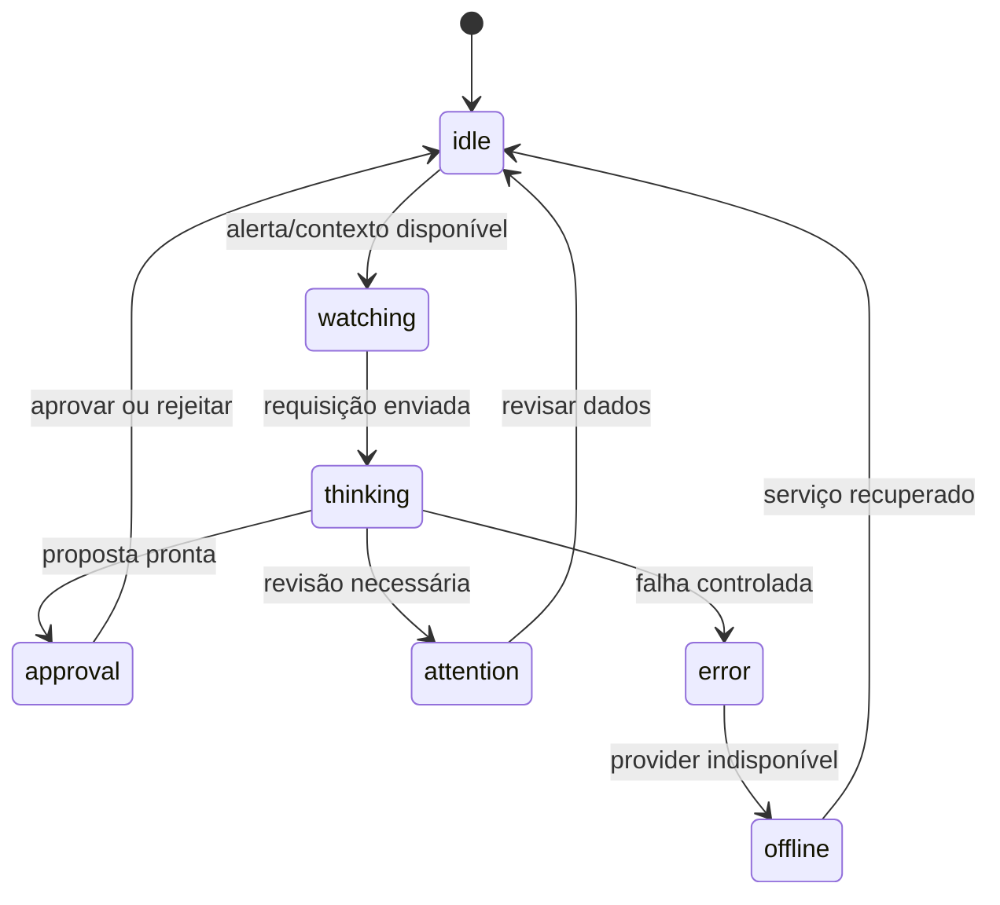
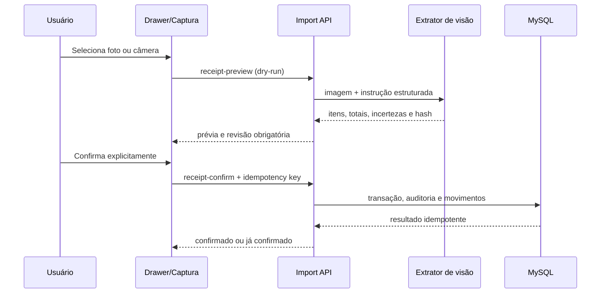

# Cocou e experiência visual do ISM Assist

## Princípios

O Cocou é uma superfície de orientação do ISM Assist, não uma fonte de dados. A interface mantém o conteúdo operacional legível sem depender de animação, respeita `prefers-reduced-motion` e usa estados visuais coerentes com o estado real do assistente.

## Componentes oficiais

| Componente | Responsabilidade |
|---|---|
| `AgentMascot2D.vue` | Mascote SVG inline, responsivo, acessível e animado por CSS |
| `AssistantMascot.vue` | Superfície compacta e abertura do drawer |
| `AssistantChatDrawer.vue` | Conversa, histórico, estados de carregamento e captura de recibo |
| `AssistantReceiptCapture.vue` | Seleção/câmera, rotação, prévia editável e confirmação explícita |
| `useAssistantUi.ts` | Estado de abertura, contexto e visibilidade |
| `useAssistantChat.ts` | Threads, mensagens, concorrência de requisições e fallback de UI |
| `useAgentMascotMotion.ts` | Reação ao ponteiro e movimento controlado |

## Estados visuais

Os estados não executam ações. Eles apenas refletem `AssistantStatus`, resultado da API ou estado local de carregamento.

## Movimento e acessibilidade

- Respiração, piscar, squash e raios são animações CSS curtas e não bloqueantes.
- `prefers-reduced-motion: reduce` remove animações e transições.
- O mascote interativo tem foco visível, rótulo acessível e tamanho responsivo.
- O drawer continua utilizável por teclado e com o mascote estático.
- Erros e revisão são comunicados por texto; cor e animação são apenas reforços.

## Imagens, ícones e diagramas

O mascote principal é SVG gerado no componente, portanto não depende de sprite raster ou download externo. PNGs de marca ficam em `frontend/public/logos/`; ícones e imagens de domínio ficam em `frontend/assets/images/` ou nos diretórios públicos correspondentes. O corpus de recibos sintéticos em `docs/Imagens de notas/` é material de teste QA e não é carregado na interface.

Diagramas desta documentação usam Mermaid e devem permanecer próximos da regra que explicam. Imagens raster só devem ser adicionadas quando representam uma referência visual, fixture de teste ou material de marca; não devem substituir texto operacional, critérios de aceite ou estados acessíveis.

## Fluxo multimodal de recibo

Prévia nunca grava estoque. A confirmação valida tenant, documento, chave idempotente, conflitos e matemática antes de persistir movimentos e auditoria.

## Referências de implementação

- `frontend/components/assistant/AgentMascot2D.vue`
- `frontend/components/assistant/AssistantMascot.vue`
- `frontend/components/assistant/AssistantChatDrawer.vue`
- `frontend/components/assistant/AssistantReceiptCapture.vue`
- `frontend/composables/useAgentMascotMotion.ts`
- `frontend/composables/useAssistantChat.ts`
- `frontend/composables/useAssistantUi.ts`
